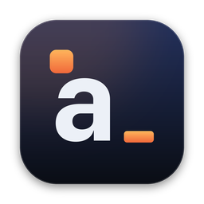
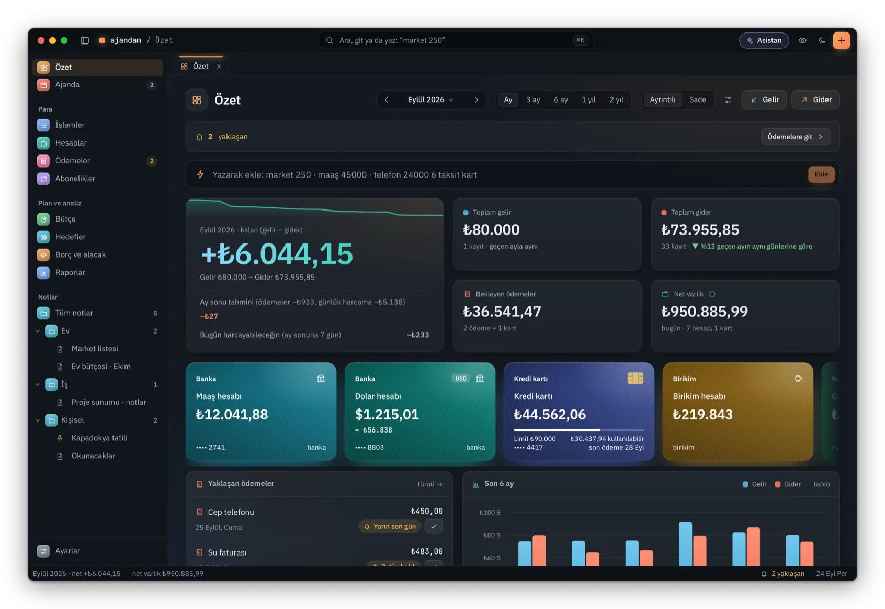

<!-- Review when any of these change: store regions ("for now"), the Google Play launch, hire status (keep in sync with GitHub's "Available for hire"). Last checked: 2026-11-23 -->

  <a href="https://tolgacodes-dev.github.io">
    <picture>
      <source media="(prefers-color-scheme: dark)" srcset="assets/header-dark.svg">
      <source media="(prefers-color-scheme: light)" srcset="assets/header-light.svg">
      
    </picture>
  </a>

I'm Tolga, a developer building web, desktop and mobile apps with JavaScript, TypeScript, React and Swift. I make Ajandam, a personal finance, calendar and notes app for Mac, Windows, iPhone, iPad and Android. I'm available for hire.

**[Ajandam](https://ajandam.dev/en/)** · **[Portfolio](https://tolgacodes-dev.github.io)** · **[X (@tolgacodeai)](https://x.com/tolgacodeai)** · Türkçe: <a href="https://ajandam.dev" hreflang="tr">ajandam.dev</a> · <a href="https://tolgacodes-dev.github.io/tr/" hreflang="tr">portfolyo</a>

## Ajandam

<a href="https://ajandam.dev/en/"><strong>Ajandam</strong></a> is a personal finance, calendar and notes app made for Türkiye: card installments and minimum payments, an inflation report, the rent increase cap, public holidays. Your records stay on your device, and an optional account syncs them between your devices with end-to-end encryption. No ads, no tracking, no subscription. 

- **App stores** (Türkiye only for now): [App Store for Mac, iPhone and iPad](https://apps.apple.com/tr/app/ajandam-finans-ve-ajanda/id6820753420) · [Microsoft Store](https://apps.microsoft.com/detail/9pmn6pvqtq2c?hl=tr-TR&gl=TR)
- **Direct downloads:** [Mac (.dmg)](https://ajandam.dev/indir/mac) · [Windows (.exe)](https://ajandam.dev/indir/windows) · [Android (.apk)](https://ajandam.dev/indir/android)

  <a href="https://github.com/tolgacodes-dev/ajandam#ekranlar">
    <picture>
      <source media="(prefers-color-scheme: dark)" srcset="assets/ajandam-overview-dark.webp">
      <source media="(prefers-color-scheme: light)" srcset="assets/ajandam-overview-light.webp">
      
    </picture>
  </a>
   
  The interface is in Turkish. The names, amounts and records in the screenshot are made up.

I design, build and ship Ajandam on my own. Updates are verified with the app's own signing key before they install, and the built-in assistant needs no API key: it runs on Apple Intelligence, a local model or your ChatGPT account. [Watch the three-minute tour](https://ajandam.dev/#film) (Turkish voice-over, English captions).

Free for personal use. The source is closed; releases, the changelog and docs are in [tolgacodes-dev/ajandam](https://github.com/tolgacodes-dev/ajandam).

## Open source contributions

- **[laravel/laravel #6891](https://github.com/laravel/laravel/pull/6891)** (merged): render JSON exceptions for the API root path.
- **[Nöbetçi](https://github.com/tahap0l/nobetci)**, a desktop app for watching Claude Code sessions and approving their permission requests (Rust, Tauri 2). I'm a collaborator on the project: animated full-body mascots ([#21](https://github.com/tahap0l/nobetci/pull/21)), the 2.1.7 release ([#22](https://github.com/tahap0l/nobetci/pull/22)) and the 2.5.0 audit fixes with a stricter risk engine ([#40](https://github.com/tahap0l/nobetci/pull/40)).
